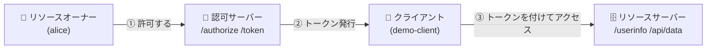
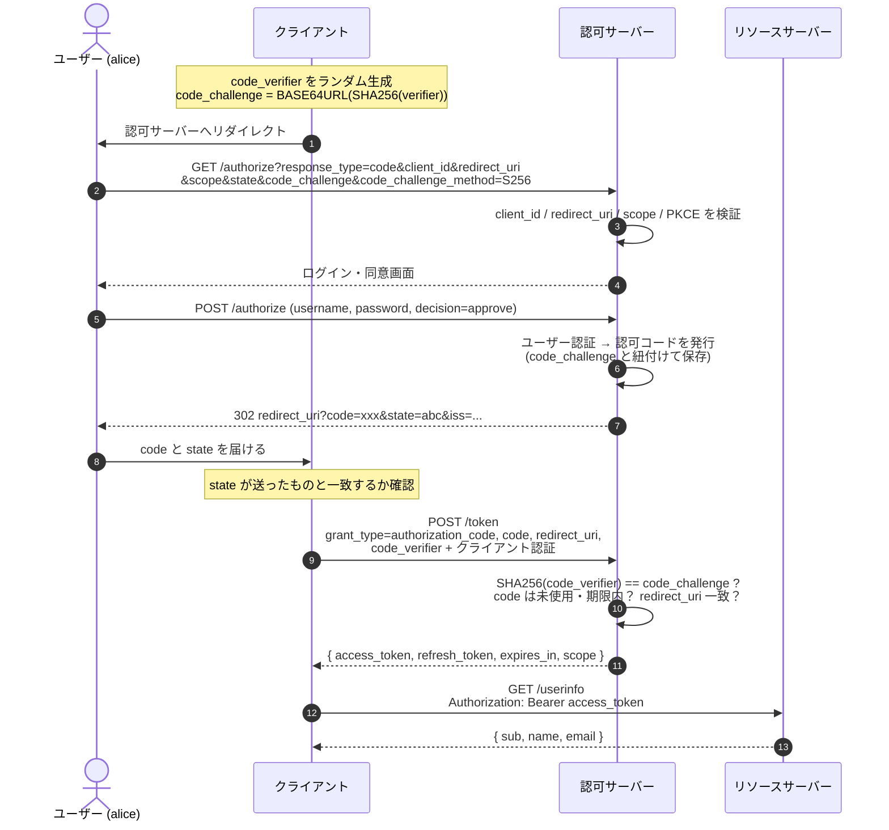
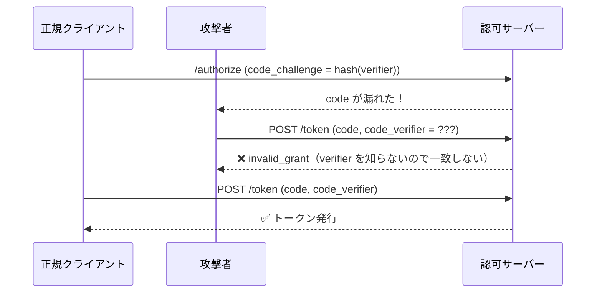
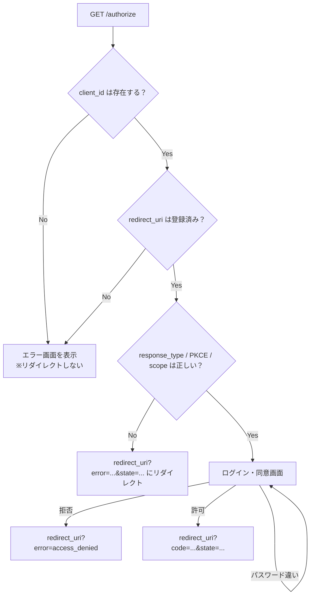
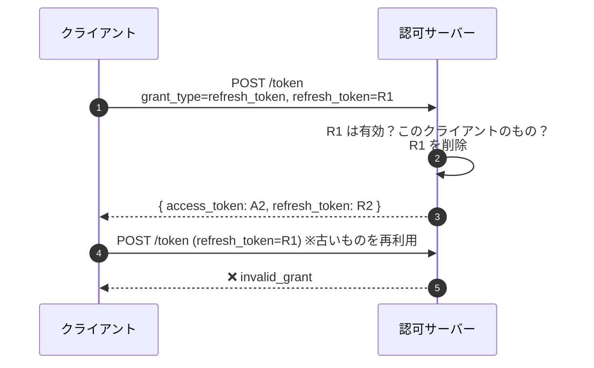
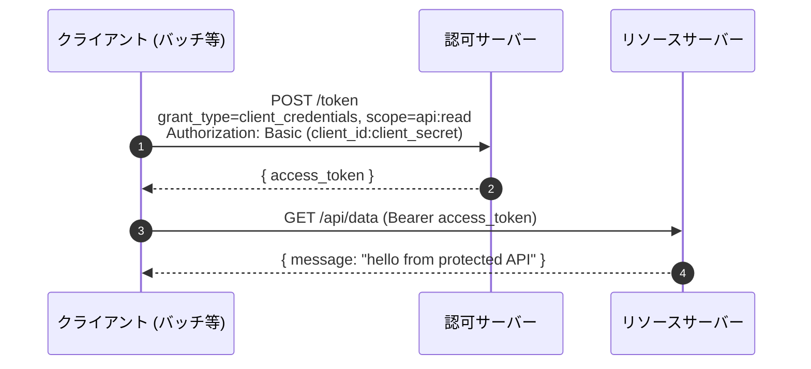
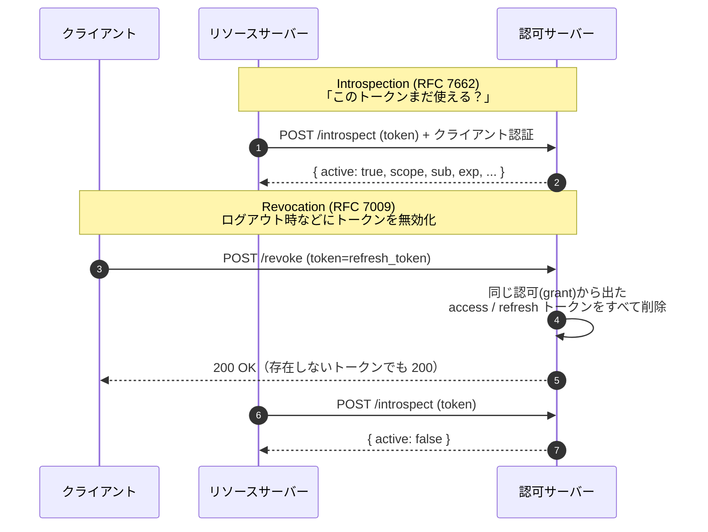
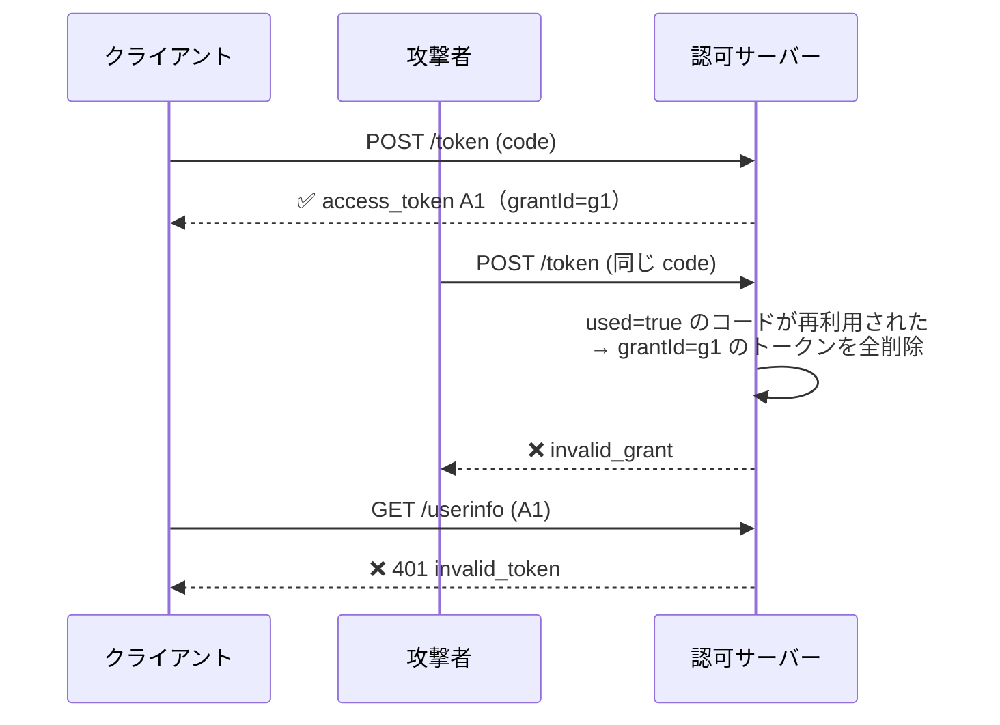

# oauth-server-hono

Hono で作った練習用の OAuth 2.0 認可サーバー。データはすべてインメモリ（再起動で消える）。

```sh
pnpm install
pnpm dev      # http://localhost:3000
pnpm test     # 結合テスト
```

> 3000 番が使用中なら 3001, 3002, ... と空いているポートを自動で使う（`PORT=4000 pnpm dev` で開始番号を変更可）。
> issuer や demo の redirect_uri も実際のポートに合わせて変わる。実際のポートは起動ログ `OAuth server listening on http://localhost:XXXX` で確認できる。

---

## OAuth 2.0 ってなに？

一言でいうと **「パスワードを渡さずに、アプリに "限られた権限" を貸す仕組み」**。

たとえば「写真印刷アプリ」に Google フォトの写真を読ませたいとき、Google のパスワードを印刷アプリに教えるのは危険。
代わりに Google（認可サーバー）が「写真の読み取りだけできる、期限付きの鍵（アクセストークン）」を印刷アプリに渡す。これが OAuth。

### 登場人物

| 役割 | 説明 | このリポジトリでは |
| --- | --- | --- |
| **リソースオーナー** | データの持ち主（人間） | `alice`, `bob` |
| **クライアント** | ユーザーのデータを使いたいアプリ | `demo-client`, `public-client` |
| **認可サーバー** | ユーザーを認証し、トークンを発行する | このサーバーの `/authorize`, `/token` |
| **リソースサーバー** | トークンを見てデータを返す API | このサーバーの `/userinfo`, `/api/data` |

> 本来、認可サーバーとリソースサーバーは別のサーバーであることが多いが、練習用なので 1 つにまとめている。



### 用語

| 用語 | 意味 |
| --- | --- |
| **アクセストークン** | API を叩くための鍵。有効期限は短い（ここでは 1 時間） |
| **リフレッシュトークン** | アクセストークンを再発行するための鍵。有効期限は長い（ここでは 30 日） |
| **認可コード (code)** | トークンと交換するための引換券。1 回限り・短命（5 分） |
| **スコープ (scope)** | トークンでできることの範囲。`profile`, `email`, `api:read` |
| **state** | CSRF 対策のためにクライアントが付けるランダム値。戻ってきたときに一致を確認する |
| **PKCE** | 認可コードが盗まれても使えないようにする仕組み（後述） |
| **confidential / public クライアント** | シークレットを安全に保管できるか（サーバーアプリ）／できないか（SPA・スマホアプリ） |

---

## フロー 1: Authorization Code + PKCE（いちばん大事）

ユーザーがログインして、アプリに権限を与える一般的なフロー。



### なぜ code を一度挟むの？

ブラウザのリダイレクト（URL）は履歴やログに残りやすい。そこにトークンそのものを乗せるのは危険なので、
URL には短命な「引換券（code）」だけを乗せ、トークンはサーバー間の通信（`POST /token`）で受け取る。

### PKCE はなにを防いでいる？

悪意のあるアプリが code を横取りしても、**`code_verifier` は正規のクライアントしか知らない**のでトークンに交換できない。



> この実装では OAuth 2.1 の方針に合わせて、**全クライアントで PKCE (S256) を必須**にしている。

### エラーのとき



`redirect_uri` が怪しいときにリダイレクトしてしまうと、攻撃者のサイトへユーザーを飛ばせてしまう（オープンリダイレクタ）。だからその場合だけはエラー画面を出す。

---

## フロー 2: Refresh Token

アクセストークンが切れたら、ユーザーに再ログインさせずにリフレッシュトークンで再発行する。
この実装では **使ったリフレッシュトークンは捨てて新しいものを返す（ローテーション）**。



`scope` パラメータを付ければ、元の範囲内でスコープを狭めることもできる（広げるのは `invalid_scope`）。

---

## フロー 3: Client Credentials

ユーザーが関わらない、**サーバー同士（マシン間）**の通信用。クライアント自身の権限でトークンを取る。
ユーザーがいないので `/userinfo` は使えず、リフレッシュトークンも発行されない。public クライアントは使えない。



---

## フロー 4: Introspection と Revocation



---

## 認可コードの再利用検知

認可コードが 2 回使われたら「漏れたかもしれない」と判断し、そのコードから発行したトークンもまとめて失効させる（RFC 6749 4.1.2）。
内部では、1 回の認可ごとに `grantId` を振って、コード・アクセストークン・リフレッシュトークンを紐付けている。



---

## エンドポイント一覧

| エンドポイント | 説明 | 仕様 |
| --- | --- | --- |
| `GET /authorize` | ログイン・同意画面を表示 | RFC 6749, 7636 |
| `POST /authorize` | ログインして認可コードを発行 | RFC 6749, 9207 (`iss`) |
| `POST /token` | `authorization_code` / `refresh_token` / `client_credentials` | RFC 6749 |
| `POST /introspect` | トークンの状態を確認（confidential クライアントのみ） | RFC 7662 |
| `POST /revoke` | トークンを失効 | RFC 7009 |
| `GET /userinfo` | ユーザー情報（`profile` スコープ必須、`email` があればメールも返す） | — |
| `GET /api/data` | 保護 API の例（`api:read` スコープ必須） | RFC 6750 |
| `GET /.well-known/oauth-authorization-server` | サーバーのメタデータ | RFC 8414 |
| `GET /demo/callback` | 動作確認用のコールバック画面（本来はクライアント側の画面） | — |

クライアント認証は次の 3 通りに対応:

- `client_secret_basic`: `Authorization: Basic base64(client_id:client_secret)`（curl なら `-u id:secret`）
- `client_secret_post`: ボディに `client_id` と `client_secret`
- `none`: public クライアントはボディに `client_id` だけ

## 初期データ（`src/store.ts`）

| 種類 | ID | シークレット / パスワード | 使えるスコープ |
| --- | --- | --- | --- |
| confidential クライアント | `demo-client` | `demo-secret` | `profile email api:read` |
| public クライアント | `public-client` | なし | `profile email` |
| ユーザー | `alice` | `password` | — |
| ユーザー | `bob` | `password` | — |

redirect_uri はどちらのクライアントも `<サーバーのURL>/demo/callback`（例: `http://localhost:3000/demo/callback`）。

---

## 手で試す

コードブロックを**上から順に、同じターミナルにそのまま貼り付ければ動く**ようにしてある。
値（code やトークン）はシェル変数に入れて次のステップに引き継ぐので、手で書き換える場所はない。

### 0. 準備

```sh
# サーバーの URL（起動ログのポートが 3000 以外ならここだけ変える）
BASE=http://localhost:3000

# JSON から値を取り出す小さな関数（jq の代わり）
json() { node -e 'let s="";process.stdin.on("data",d=>s+=d).on("end",()=>console.log(JSON.parse(s)[process.argv[1]]))' "$1"; }

# サーバーが動いているか確認（JSON が出れば OK）
curl -s $BASE/.well-known/oauth-authorization-server
```

### 1. Authorization Code + PKCE

```sh
# 1. PKCE の code_verifier と code_challenge を作る
VERIFIER=$(openssl rand -base64 32 | tr '+/' '-_' | tr -d '=')
CHALLENGE=$(printf %s "$VERIFIER" | openssl dgst -sha256 -binary | openssl base64 | tr '+/' '-_' | tr -d '=')

# 2. 認可 URL を作る → 出てきた URL をブラウザで開いてログイン（alice / password）
echo "$BASE/authorize?response_type=code&client_id=demo-client&redirect_uri=$BASE/demo/callback&scope=profile%20email&state=abc&code_challenge=$CHALLENGE&code_challenge_method=S256"
```

ログインして「許可する」を押すと `/demo/callback` に飛び、**code が埋め込まれたコマンド**が表示される。
それをコピーして貼り付ける（中身は次と同じ。`CODE=` の値だけ毎回違う）:

```sh
# 3. code をトークンに交換し、トークンを変数に保存
CODE=_WuLHH-biu0l6yW2fdhufCJK9yHwRdl9LI2coLCVvs4   # ← 例。画面に表示された自分の値を使う
TOKENS=$(curl -s -X POST $BASE/token -u demo-client:demo-secret \
  -d grant_type=authorization_code -d code=$CODE \
  -d redirect_uri=$BASE/demo/callback -d code_verifier=$VERIFIER)
echo "$TOKENS"
ACCESS_TOKEN=$(echo "$TOKENS" | json access_token)
REFRESH_TOKEN=$(echo "$TOKENS" | json refresh_token)
```

```sh
# 4. 保護リソースにアクセス
curl -s $BASE/userinfo -H "Authorization: Bearer $ACCESS_TOKEN"; echo
```

> 💡 ブラウザを使わずに 1〜3 を一気にやるなら（ログインフォームの POST を curl で再現する）:
>
> ```sh
> VERIFIER=$(openssl rand -base64 32 | tr '+/' '-_' | tr -d '=')
> CHALLENGE=$(printf %s "$VERIFIER" | openssl dgst -sha256 -binary | openssl base64 | tr '+/' '-_' | tr -d '=')
> LOCATION=$(curl -s -o /dev/null -w '%{redirect_url}' -X POST $BASE/authorize -H "Origin: $BASE" \
>   -d response_type=code -d client_id=demo-client -d redirect_uri=$BASE/demo/callback \
>   -d scope='profile email' -d state=abc -d code_challenge=$CHALLENGE -d code_challenge_method=S256 \
>   -d username=alice -d password=password -d decision=approve)
> echo "$LOCATION"
> CODE=$(echo "$LOCATION" | sed -E 's/.*[?&]code=([^&]+).*/\1/')
> TOKENS=$(curl -s -X POST $BASE/token -u demo-client:demo-secret \
>   -d grant_type=authorization_code -d code=$CODE \
>   -d redirect_uri=$BASE/demo/callback -d code_verifier=$VERIFIER)
> echo "$TOKENS"
> ACCESS_TOKEN=$(echo "$TOKENS" | json access_token)
> REFRESH_TOKEN=$(echo "$TOKENS" | json refresh_token)
> ```

### 2. Refresh Token

```sh
# 新しいトークンで変数を上書きする（古い refresh token はもう使えない）
TOKENS=$(curl -s -X POST $BASE/token -u demo-client:demo-secret \
  -d grant_type=refresh_token -d refresh_token=$REFRESH_TOKEN)
echo "$TOKENS"
ACCESS_TOKEN=$(echo "$TOKENS" | json access_token)
REFRESH_TOKEN=$(echo "$TOKENS" | json refresh_token)
```

### 3. Introspection / Revocation

```sh
# トークンの状態を確認 → "active": true
curl -s -X POST $BASE/introspect -u demo-client:demo-secret -d token=$ACCESS_TOKEN; echo

# refresh token を失効させる（同じ grant の access token も一緒に失効する）
curl -s -X POST $BASE/revoke -u demo-client:demo-secret -d token=$REFRESH_TOKEN

# もう一度確認 → "active": false
curl -s -X POST $BASE/introspect -u demo-client:demo-secret -d token=$ACCESS_TOKEN; echo
```

### 4. Client Credentials

```sh
CC_TOKEN=$(curl -s -X POST $BASE/token -u demo-client:demo-secret \
  -d grant_type=client_credentials -d scope=api:read | json access_token)
curl -s $BASE/api/data -H "Authorization: Bearer $CC_TOKEN"; echo
```

---

## ファイル構成

```
src/
├── index.ts                     # サーバー起動
├── app.tsx                      # ルーティング・メタデータ・demo callback
├── store.ts                     # インメモリストア（Map）と初期データ
├── oauth.ts                     # クライアント認証・エラーレスポンスなどの共通処理
├── crypto.ts                    # ランダムトークン生成・PKCE 検証・安全な比較
├── views.tsx                    # ログイン画面などの HTML（hono/jsx）
└── routes/
    ├── authorize.tsx            # /authorize
    ├── token.ts                 # /token
    ├── tokens-management.ts     # /introspect, /revoke
    └── resource.ts              # /userinfo, /api/data（Bearer 検証ミドルウェア）
test/
└── oauth.test.ts                # フロー全体の結合テスト
```

## 入っているセキュリティ上の工夫

- 未登録の `redirect_uri` にはリダイレクトせずエラー画面を出す（オープンリダイレクタ対策）
- 全クライアントで PKCE (S256) 必須
- 認可コードは 5 分・1 回限り。再利用されたら関連トークンをすべて失効
- リフレッシュトークンのローテーション
- クライアントシークレットやパスワードの比較は `timingSafeEqual`（タイミング攻撃対策）
- ログインフォームは Hono の `csrf()` で Origin を検証、`secureHeaders()` でフレーム埋め込みを禁止（クリックジャッキング対策）
- トークンレスポンスに `Cache-Control: no-store`
- 認可レスポンスに `iss` を付与（RFC 9207、mix-up 攻撃対策）

## 練習用として割り切っている点

- パスワードは平文で保存
- ログインセッション（Cookie）がないので、毎回パスワードを入力する
- アクセストークンは JWT ではなくランダム文字列（検証にはストア参照 or introspection が必要）
- 再起動でデータが消える

## 発展課題のアイデア

- アクセストークンを JWT にして `/.well-known/jwks.json` を公開する
- OpenID Connect（`openid` スコープ、ID トークン）に対応する
- SQLite（`node:sqlite` や `better-sqlite3`）で永続化する
- パスワードをハッシュ化し、ログインセッションを持って同意画面を分ける
- Dynamic Client Registration（RFC 7591）
