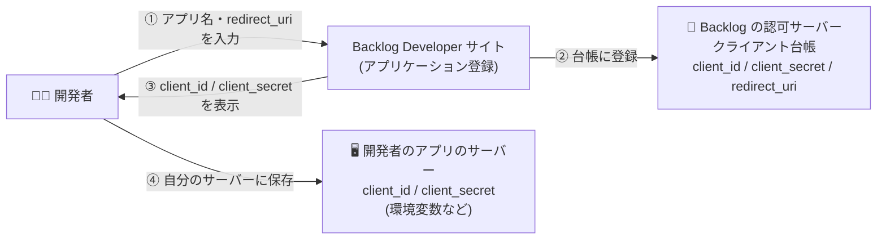
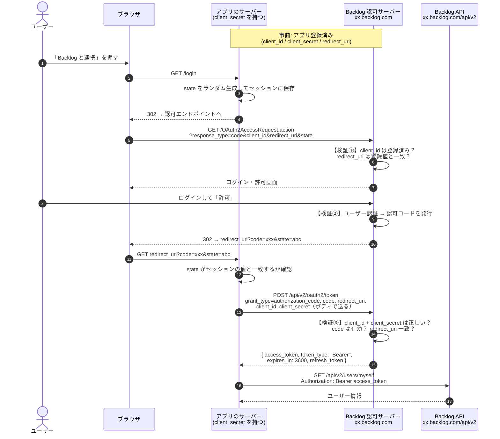
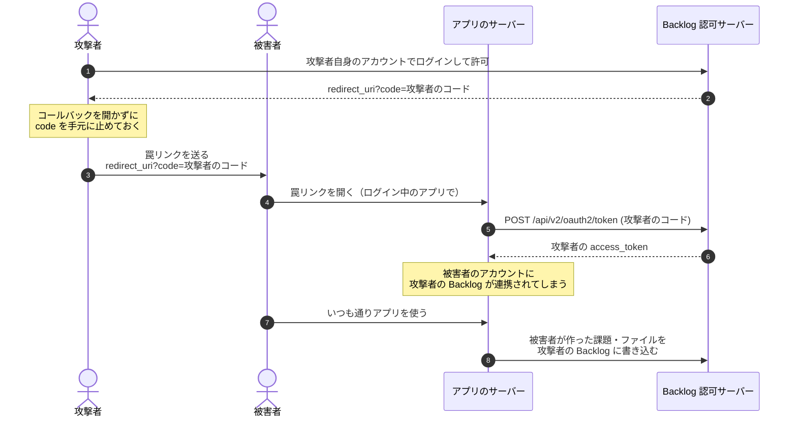
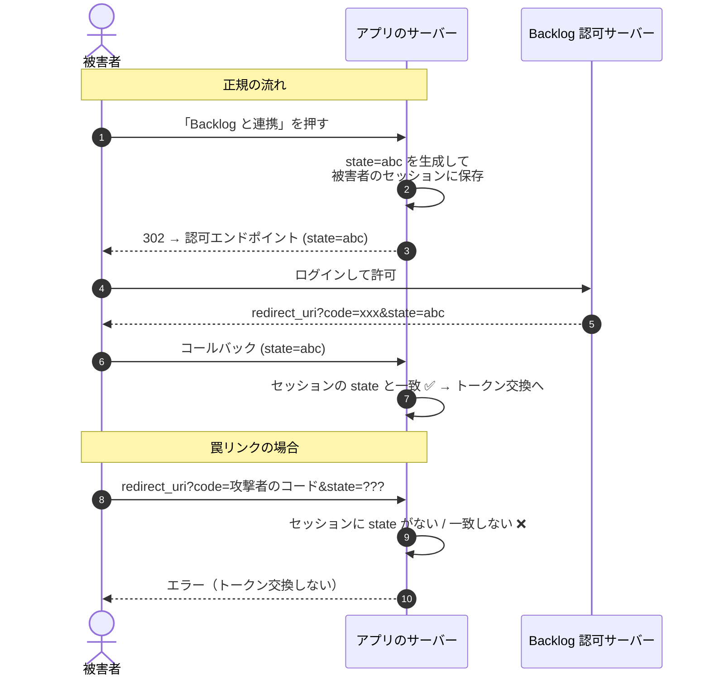
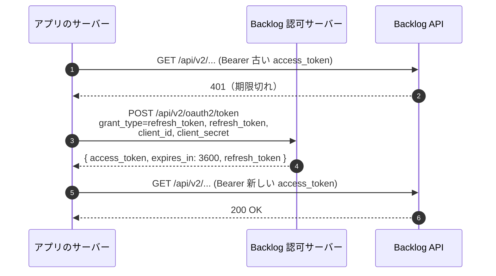

# Backlog の OAuth 2.0

Backlog API を OAuth 2.0 で使うときの流れを、このリポジトリ（`README.md`）の用語に当てはめて整理したもの。

参考: [Backlog API 認証と認可](https://developer.nulab.com/ja/docs/backlog/auth/)

---

## アプリ登録した時点で、認可サーバーに登録されている？

**されている。** Backlog Developer サイトでアプリケーションを登録する操作が、OAuth の **クライアント登録**（RFC 6749 2 章）にあたる。

登録した瞬間に、認可サーバー（Backlog）は次の内容をクライアントの台帳に記録する。

| 項目 | 誰が決める | 認可サーバーでの使われ方 |
| --- | --- | --- |
| `client_id` | Backlog が発行 | どのアプリからのリクエストかを見分ける |
| `client_secret` | Backlog が発行 | `/api/v2/oauth2/token` で送られてきた値と照合する |
| `redirect_uri` | 開発者が入力 | 認可リクエスト・トークンリクエストの `redirect_uri` と**一致するか**を確認する |

このリポジトリでいうと、`src/store.ts` の `seed()` にある `clients.set('demo-client', { ... })` が、Backlog ではアプリ登録画面の操作になっている。



登録が終わると、client_secret は**認可サーバー（Backlog）と、開発者のアプリのサーバーの 2 か所だけ**にある状態になる。
ブラウザやフロントエンドのコードには絶対に入れない。

---

## 全体の流れ（Authorization Code）

`xx.backlog.com` は自分のスペースのホスト（`xx.backlog.jp` の場合もある）。



### 各ステップで何をしているか

1. **認可リクエスト**（ブラウザ経由）
   `GET https://xx.backlog.com/OAuth2AccessRequest.action`

   | パラメータ | 必須 | 内容 |
   | --- | --- | --- |
   | `response_type` | ✅ | `code` 固定 |
   | `client_id` | ✅ | 登録で発行された値 |
   | `redirect_uri` | ✅ | **登録した値と同じもの** |
   | `state` | 任意 | CSRF 対策のランダム値（実際には必ず付ける） |

   ここには **client_secret を付けない**。URL はブラウザを通るので、client_id しか載せない。

2. **ログイン・許可**
   ユーザーが Backlog にログインして許可すると、`redirect_uri?code=...&state=...` にリダイレクトされる。

3. **トークン取得**（アプリのサーバー → Backlog、ブラウザを通らない）
   `POST https://xx.backlog.com/api/v2/oauth2/token`（`application/x-www-form-urlencoded`）

   | パラメータ | 必須 | 内容 |
   | --- | --- | --- |
   | `grant_type` | ✅ | `authorization_code` |
   | `code` | ✅ | 2 で受け取った認可コード |
   | `redirect_uri` | ✅ | 1 と同じ値 |
   | `client_id` | ✅ | |
   | `client_secret` | ✅ | **ここで初めて secret を使う** |

   レスポンス:

   ```json
   {
     "access_token": "...",
     "token_type": "Bearer",
     "expires_in": 3600,
     "refresh_token": "..."
   }
   ```

4. **API 呼び出し**
   `Authorization: Bearer <access_token>` を付けて `/api/v2/...` を呼ぶ。
   トークンが無効・期限切れなら `401` が返り、`WWW-Authenticate` ヘッダーに理由が入る。

---

## なぜ state があるの？

state は **CSRF 対策**のための値。ドキュメント上は任意だが、実際には必ず付ける。

「このコールバック（`redirect_uri?code=...`）は、**このブラウザの、このユーザーが自分で始めた**連携の続きか？」をアプリが確かめるために使う。
認可コード（`code`）だけでは、それが誰の連携で発行されたコードなのかアプリには分からない。

### state がないと何が起きる？

攻撃者が**自分の** Backlog アカウントで発行させた code を、被害者のブラウザに踏ませる攻撃ができてしまう。



被害者は自分の Backlog と連携しているつもりで、**課題やファイルを攻撃者のスペースに送ってしまう**。
被害者が操作したのは罠リンクを開いただけなので、気付きにくい。

### state があると



攻撃者は被害者のセッションに保存された state を知らないので、正しい state を付けた罠リンクを作れない。

### state を使うときのポイント

- **推測できないランダム値**にする（連番や固定値はダメ）
- **ブラウザのセッション（Cookie）に紐付けて保存**し、コールバックで一致を確認する
- **1 回使ったら捨てる**
- 一致しなければ、**code をトークンと交換せずに**エラーにする

> このリポジトリ（oauth-server-hono）では PKCE も必須にしている。PKCE でも「連携を始めた本人か」を確かめられるので、同じ攻撃を防げる。
> Backlog のドキュメントには PKCE の記載がないので、**state が唯一の防御**になる。だから Backlog では state を必ず付ける。

---

## アクセストークンの更新（Refresh Token）

アクセストークンの有効期限は **1 時間**。切れたらリフレッシュトークンで取り直す。



更新のときも **client_secret が必須**。だからリフレッシュもアプリのサーバーで行う。

---

## このリポジトリ（oauth-server-hono）との違い

| | oauth-server-hono | Backlog |
| --- | --- | --- |
| クライアント登録 | `src/store.ts` の `seed()` に直書き | Backlog Developer サイトで登録 |
| 認可エンドポイント | `GET /authorize` | `GET /OAuth2AccessRequest.action` |
| トークンエンドポイント | `POST /token` | `POST /api/v2/oauth2/token` |
| クライアント認証 | Basic / ボディ / なし（public） | **ボディ**（`client_id` + `client_secret`） |
| client_secret | confidential は必須、public はなし | **常に必須** |
| PKCE | 全クライアントで必須 | ドキュメントに記載なし |
| scope | `profile` `email` `api:read` | ドキュメントに記載なし |
| アクセストークンの期限 | 1 時間 | 1 時間 |
| `client_credentials` | 対応 | ドキュメントに記載なし |

Backlog では client_secret が必須なので、トークン取得は **secret を隠せるサーバー側でやる前提**になっている（confidential client）。
SPA やスマホアプリだけで完結させると secret を埋め込むことになるので、トークン交換は自前のバックエンドを経由させる。
